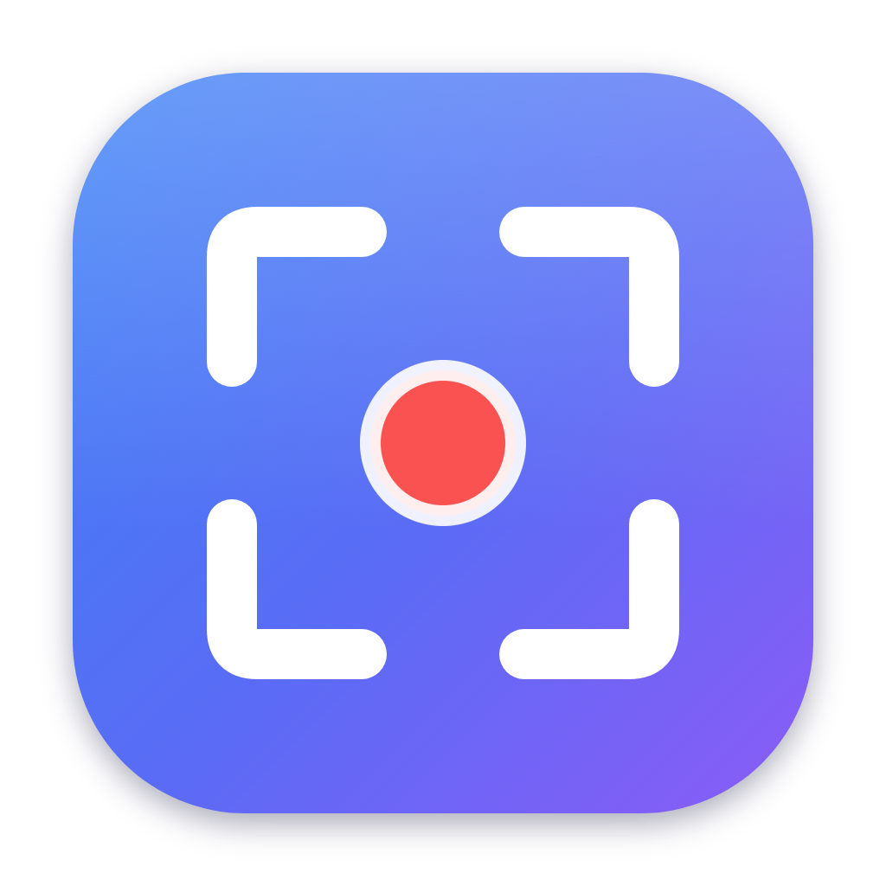
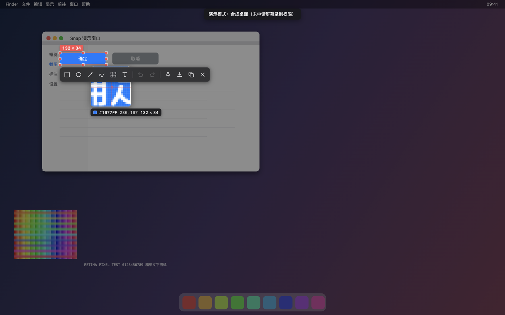
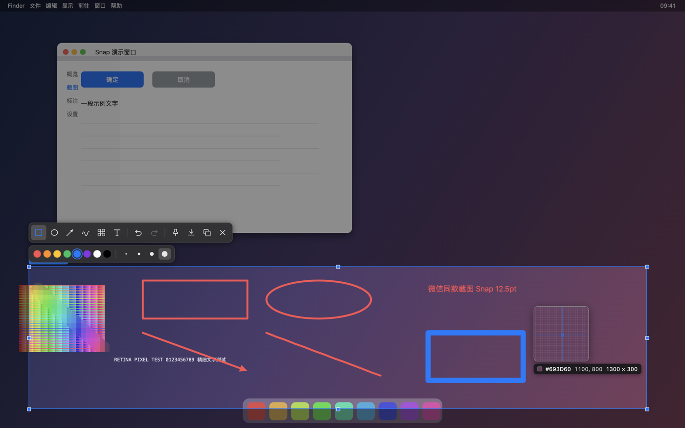

<div align="center">



# Snap 截图

**macOS 截图工具 · 微信桌面端截图同款交互**

按 `⌃⌘A` 随时截图：整屏冻结变暗 → 智能识别窗口/控件 → 拖拽框选 → 放大镜取色 → 六种标注 → 复制 / 保存 / 钉在屏幕上。

只有全局快捷键能拉起截图（点击菜单栏图标或其他入口都不会），所有设置与
API 调试台集中在「截图 · 设置 · 说明 / API 调试台」双页签的**控制台**里。

菜单栏常驻，不占 Dock 栏。Intel 与 Apple 芯片通用。

</div>





---

## 下载安装

从 [Releases](../../releases) 下载 **`Snap-1.0.0-mac-universal.dmg`**（Intel + Apple 芯片通用，推荐）
或 `Snap-1.0.0-mac-universal.zip`，校验收据见同页 `SHA256SUMS.txt`。

安装：打开 dmg，把 **Snap 截图.app** 拖进 `应用程序`。

> 应用没有 Apple 开发者签名，首次打开会被 Gatekeeper 拦住。任选一种方式放行：
> - 在 `应用程序` 里 **右键 → 打开**，再点“打开”；
> - 或执行一次：`xattr -dr com.apple.quarantine "/Applications/Snap 截图.app"`
>
> 建议移动/复制到 `/Applications` 再打开，这样“开机自动启动”才能被系统正确登记。

### 首次授权（重要）

1. **屏幕录制**：第一次按 ⌃⌘A 时系统会弹窗，去
   `系统设置 → 隐私与安全性 → 屏幕录制` 勾选 **Snap 截图**，然后**重新启动应用**。
   未授权时截图只能看到桌面壁纸。
2. **辅助功能**（可选，用于“智能识别”）：勾选后光标下的**按钮、文字等控件**会被精确高亮；
   未授权时只能识别到整扇窗口。路径：`系统设置 → 隐私与安全性 → 辅助功能`。

应用内点菜单栏图标 → “使用说明 / 设置…”，可以直接跳到这两个面板并查看授权状态。

---

## 功能

**截图**
- 全局快捷键 ⌃⌘A（`SNAP_HOTKEY` 环境变量可改）
- 多显示器：每块屏都能框选，鼠标所在屏优先响应
- 智能识别：光标悬停即高亮整窗；装了辅助功能权限后精确到控件，单击即选中
- 拖拽框选，8 个控制点微调，方向键 1px / Shift+方向键 10px 微调
- 放大镜跟随光标：像素级放大、坐标、取色（HEX）、实时尺寸
- 选区尺寸气泡、选区边框与控制点跟随当前标注颜色
- ⇧ 拖拽 = 正方形 / 正圆 / 45° 箭头

**标注**（默认红色，可换 8 色 + 4 档粗细）
- 矩形、椭圆、箭头、画笔（平滑曲线）、马赛克（真实像素化，块大小 10pt）、文字
- 撤销 / 重做，标注被裁剪在选区内，导出时按原生分辨率重新渲染（不含 UI）

**输出**
- 复制到剪贴板（⌘C / ⏎ / 双击选区）
- 保存 PNG（⌘S），默认存到 `~/图片/Snap截图_20251017094113.png`，保存后在访达中显示
- 钉在屏幕：贴图窗口可拖动，滚轮缩放（等比）、⌘+滚轮调透明度、双击 / Esc 关闭、右键菜单

**菜单栏**
- **左键图标 = 打开控制台（总面板）**；右键 = 常用菜单。**截图只能由快捷键 ⌃⌘A 拉起**，
  任何点击入口都不会触发
- **控制台**有两个页签：「截图 · 设置 · 说明」和「API 调试台」，设置与说明全部收拢于此
- **API 调试台**（控制台第二页签）：Postman/Apifox 式的接口调试——
  方法+URL+Params/Headers/Body（JSON、表单、原文）/Auth（Bearer、Basic）、
  `{{环境变量}}` 替换、发送前预览、响应状态/耗时/大小/格式化 JSON 高亮/响应头/二进制导出、
  收藏与历史（本地持久化）。请求在主进程发出，不受浏览器跨域限制。
- **保持屏幕常亮（不息屏）**：勾选后调用 `powerSaveBlocker('prevent-display-sleep')`，
  桌面不再息屏/睡眠；设置持久化，下次启动自动生效
- **开机自动启动**：登录后自动后台运行（macOS 13+ 若提示“需要允许”，到
  `系统设置 → 通用 → 登录项` 打开）
- 权限状态一键跳转、退出

**快捷键一览**

| 操作 | 快捷键 |
| --- | --- |
| 截图 | ⌃⌘A |
| 复制并退出 | ⌘C 或 ⏎ |
| 保存 PNG | ⌘S |
| 撤销 / 重做 | ⌘Z / ⇧⌘Z |
| 全屏选区 | ⌘A |
| 开关键盘智能识别 | A 或 Tab |
| 返回上一步 / 取消 | Esc（逐级：文字 → 工具 → 选区 → 退出） |
| 重新框选 | 在选区外按下拖动 |
| 移动选区 | 在选区内拖动 |
| 文字工具：换行 / 提交 | ⇧⏎ / ⏎ |

---

## 从源码运行

```bash
npm install                 # Electron 44
npm run helper              # 编译原生 hit-test helper（需要 Xcode 命令行工具）
npm start                   # 开发模式运行
npm run selftest            # 无权限依赖的自检：53 项断言 + 截图
npm run bundle              # 打包 x64 / arm64 / universal → dist/
```

开发模式运行时，屏幕录制权限归属于 **Electron**（而不是打包后的 Snap）。

### 为什么替换安装要重新授权「屏幕录制」？如何避免

macOS 把屏幕录制等 TCC 授权记在应用的**代码签名身份**上。默认 ad-hoc 签名的身份
= 每次构建二进制的内容摘要，所以每次重新打包系统都视为“新应用”，授权失效。

本仓库已内置解决方案：**自签证书 `Snap Dev`（`assets/cert/snap-dev.p12`）随仓库共享**，
任何机器打包前先执行一次 `bash scripts/make-dev-cert.sh`（导入钥匙串并信任，
过程中系统弹确认框就点“始终信任”），之后 `npm run bundle` 会自动选用该身份。
所有机器签出的应用是**同一个签名身份**，替换安装不再丢授权（每台新机器
首次运行仍需各自授权一次屏幕录制，这是按机器记录的，无法避免）。

```bash
bash scripts/make-dev-cert.sh   # 每台机器一次
npm run bundle                  # 自动使用 Snap Dev 身份签名
SNAP_SIGN_IDENTITY="其他身份" npm run bundle   # 需要覆盖时
```

> ⚠️ 私钥随仓库分发意味着拿到仓库的人都能签出「Snap Dev」身份。
> 请保持仓库私有/小范围使用；需要收口时可重新生成证书
> （删掉 `assets/cert/snap-dev.p12` 后本机重跑：`rm -rf ~/.snap-dev-cert && bash scripts/make-dev-cert.sh`），
> 并让所有成员重新执行一次 `make-dev-cert.sh + 屏幕录制授权`。

### 自检

`npm run selftest` 用合成桌面（不需要屏幕录制权限）驱动真实 UI：
`webContents.sendInputEvent` 模拟鼠标键盘，逐项校验智能识别、选区、每个工具是否真的
改变了导出图片的像素、马赛克块是否真的按 10pt 网格一致、剪贴板与保存文件的分辨率等等，
并把每个阶段的截图写到 `build/test-out/`。

自检也会跑在打包后的 app 上（`SNAP_SELFTEST=1 SNAP_DEMO=1 "Snap.app/Contents/MacOS/Snap"`），
用来验证 bundle 本身：helper 改名、Info.plist、通用二进制都在这条路径上被验证。

### 发布

```bash
npm run bundle                                  # 产出 dist/Snap-<ver>-mac-universal.{dmg,zip}
gh release create v1.0.0 dist/*.dmg dist/*.zip  # 或用网页上传产物
```

如果所在网络对 `github.com` 的 git 传输不友好（`HTTP/2 framing layer`、`Empty reply from server`），
但 `api.github.com` 可用，可以用 REST 接口同步工作区（单次提交，不产生逐文件历史）：

```bash
node scripts/upload-tree-via-api.js <owner/repo> main "commit message"
```

---

## 结构

```
src/main.js              主进程：快捷键、多屏抓屏、覆盖窗口、剪贴板/保存/贴图、托盘、权限、API 调试代理
src/renderer/overlay.js  选区状态机、放大镜、工具栏、键盘、导出
src/renderer/api.*       API 调试台界面（主进程 fetch 代理，绕开 CORS）
src/renderer/ops.js      标注模型与渲染（含马赛克像素化、合成导出）
src/renderer/pin.*       贴图窗口
src/renderer/help.*      使用说明 / 设置（含常亮与开机启动开关）
src/winlist.swift        原生 helper：CGWindowList + AX 命中测试（stdin/stdout JSON）
scripts/build-app.sh     打包 x64 + arm64 + universal，产出 zip/dmg 与校验和
scripts/build-helper.sh  编译 x86_64 + arm64 并 lipo 成通用 helper
scripts/make-icon.js     用 canvas 渲染 AppIcon.icns
scripts/run-selftest.js  运行应用内自检
```

坐标系约定：所有标注都用“显示器 DIP 坐标”存储，屏幕渲染时按 `devicePixelRatio`
放大、导出时按“抓屏图素 / DIP”放大，因此同一份标注在预览与导出中完全一致。

## 已知差异（与微信截图相比）

- 视觉细节是仿制而非像素级复刻（工具栏图标、配色为手绘近似）
- 没有 OCR 取字 / 翻译按钮
- 不支持跨显示器一次性框选（每块屏各自框选）
- 未做 Apple 公证：首次打开需要右键放行

## License

MIT
